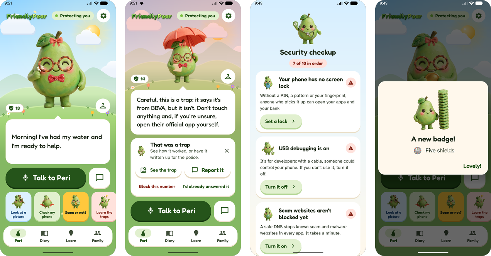
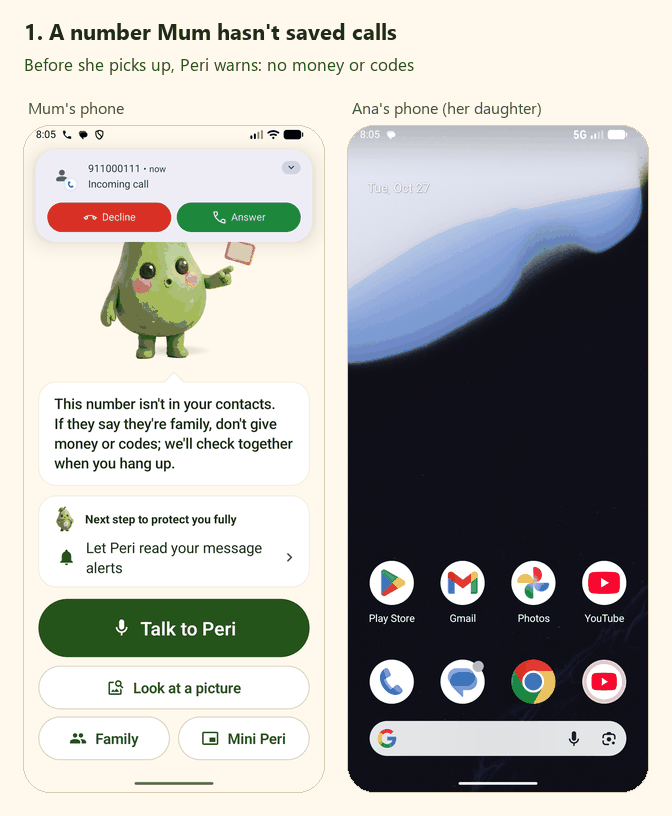
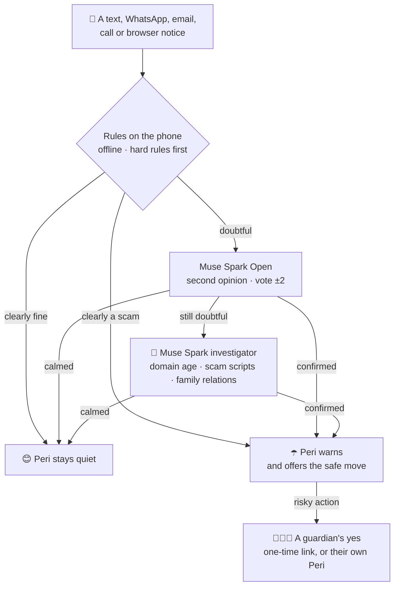
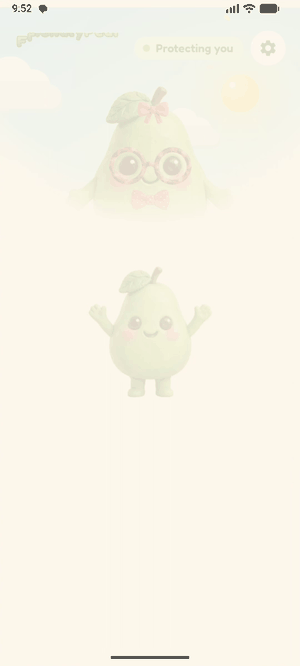
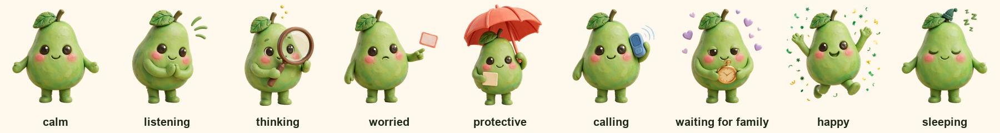
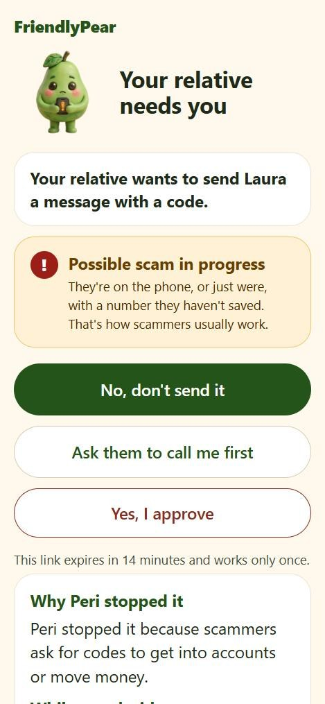
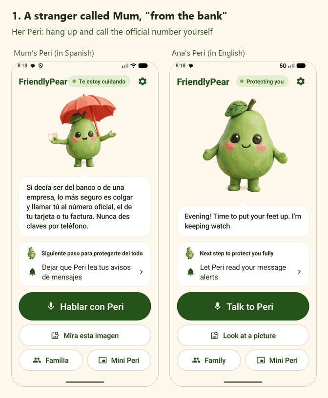

<p align="center">
  
</p>

<h1 align="center">FriendlyPear</h1>

<p align="center">
  <b>Peri, a friendly clay pear who lives in your phone, stops scams before money moves<br>
  and checks with your family before anything risky happens.</b>
</p>

<p align="center">
  <a href="https://github.com/Ruby570bocadito/FriendlyPear/actions/workflows/ci.yml"></a>
  
  
  
  
  
  <a href="LICENSE"></a>
</p>

<p align="center">
  <!-- Once the demo video is online, put it first: <a href="VIDEO_URL"><b>▶ Watch the 3-minute demo</b></a> &nbsp;·&nbsp; -->
  <a href="https://ruby570bocadito.github.io/FriendlyPear/"><b>Website</b></a> &nbsp;·&nbsp;
  <a href="https://github.com/Ruby570bocadito/FriendlyPear/releases/latest"><b>Download the app</b></a> &nbsp;·&nbsp;
  <a href="docs/INSTALL.md"><b>Install in 5 minutes</b></a> &nbsp;·&nbsp;
  <a href="docs/FEATURES.md"><b>Every feature</b></a> &nbsp;·&nbsp;
  <a href="docs/SECURITY.md"><b>Security</b></a>
</p>

<p align="center"></p>

<p align="center"><sub>Built for the <b>Meta Global AI Developer Hackathon</b> · Indie track · <i>Build for Your World</i> · all product code written Oct 27 – Nov 4, 2026 (concept and design documents were drafted before)</sub></p>

## Scams win by isolating people and rushing them


*"Mum, I broke my phone, this is my new number, can you send me money?"* *"Your bank here: read me the code you just got."*

In 2025, Americans aged 60 and over reported losing **$7.7 billion** to online crime, more than any other age group ([FBI IC3 2025](https://www.ic3.gov/AnnualReport/Reports/2025_IC3Report.pdf), via [AARP](https://www.aarp.org/money/scams-fraud/fbi-ftc-report-2025-losses.html)). Spam filters warn about everything or nothing; voice assistants call and read messages but don't judge them.

**FriendlyPear breaks the isolation.** Before anything risky happens, Peri checks through a second channel: the real family member, at the number already saved. And she does it as a friend the person wants to keep (she reads messages aloud, calls whoever they ask, keeps them company) rather than as a watchdog.

<br clear="right">

<table>
  <tr>
    <td align="center" width="33%"><br><b>She catches the trap</b><br><sub>Texts, WhatsApp, email and browser notices are checked on the phone the moment they arrive. A stranger's call is flagged before pickup, and a code arriving during a call is a scam, full stop.</sub></td>
    <td align="center" width="33%"><br><b>She asks the family first</b><br><sub>Risky actions wait for a guardian's one-time link (<i>No</i> · <i>Call me first</i> · <i>Yes</i>), marked <b>URGENT</b> after a stranger's call. If the guardian has FriendlyPear too, it opens in their own Peri.</sub></td>
    <td align="center" width="33%"><br><b>She never spies</b><br><sub>The family never reads messages, calls, location or apps. Only doubtful messages leave the phone, and Peri never hears a call.</sub></td>
  </tr>
</table>

## At a glance

| Judging criterion | Where FriendlyPear stands |
|---|---|
| **Impact** | Any Android 12+ phone, English and Spanish, made for older adults first: big type in Atkinson Hyperlegible, 7:1 contrast, a voice to talk to, and the family one tap away. |
| **Use of Meta AI** | Six Meta models, each with one job: an open-weight second opinion, an investigator agent with tools, pictures read with Muse Spark and SAM 3.1, ears for voice orders, every picture of Peri, and a red team that attacks the rules. |
| **Technical depth** | Rules on the phone that no model can override, a model's vote capped at ±2, 400 tests, a held-out evaluation with confidence intervals, per-phone keys paired in person, encrypted storage, and dependencies pinned by SHA-256. |
| **Demo** | The moments below run on the real app on the Android emulator, end to end with two phones. |

## See it work

<p align="center"></p>

Tested on the Android emulator, in English and in Spanish:

| Moment | What happens |
|---|---|
| **"I have a new number"** | A text from an unknown number claims to be the daughter and asks for money. Peri warns, finds the real daughter in the contacts and says *"If you say yes, I'll call Laura"*. One spoken "yes" and the phone calls her saved number. |
| **"Grandma, it's Pablo"** | A call rings from a number that isn't in the contacts. Before pickup Peri says: *"This number isn't in your contacts. If they say they're family, don't give money or codes; we'll check together when you hang up."* Afterwards: *"Who did they say they were?"* → "my grandson" → *"That number isn't Pablo's… Shall I call Pablo on their usual number to check?"* It never blocks, answers or listens to the call. |
| **A code during a call** | During a phone call, an SMS with a one-time code arrives. A hard rule fires at once: *"You got a code while on the phone: nobody genuine will ask for it, so hang up and don't tell anyone."* The code is never read aloud. |
| **"Send Marisa the code"** | Right after a "bank" called from an unknown number, Mum asks Peri to send a code. Peri stops and texts her daughter Ana an **URGENT** one-time link. Ana taps *"Ask them to call me first"*, and three seconds later Peri offers Mum a call to Ana. Nothing was sent. |

<p align="center"></p>

## Six Meta models, each with one job

| Model | What it does in FriendlyPear |
|---|---|
| **Muse Spark Open** (open weights, on Baseten) | The **second opinion**: only messages the rules left doubtful are sent, and the model's verdict becomes a vote of at most ±2 on the rules' score. Peri always speaks her own sentence, never the model's, so a message can't talk the model into saying something unsafe. |
| **Muse Spark** | An **investigator agent** with read-only tools for messages that are still doubtful: how old a web domain is (RDAP), cards of known scam scripts, and whether the family has the relation the sender claims (relations only, never names or numbers). At most 3 rounds and 6 lookups. It also writes the **police report** in one tap, when the person asks. |
| **Muse Spark + SAM 3.1** | **"Look at this picture"**: a letter, an invoice or a QR code. Spark reads it and SAM 3.1 marks the QR code with a red ring, while the phone itself judges where the code would lead without opening it. Tested on the real API with a fake parcel notice: scam (97 %), QR marked exactly, 5.8 s. |
| **Muse Voice Transcribe** | **Peri's ears**, if the person turns it on: voice orders recorded on the phone (it stops only after a long pause, for people who speak slowly) and written down by Meta's speech model. Off by default. |
| **Muse Image** | **Every picture of Peri**: nine moods in soft clay, each an edit of one base so she's always the same character, with blinks, mouth shapes, steps and gestures (over 400 pictures in the app), her wardrobe, and the comics that show how each trap works. |
| **Muse Spark contributor · Muse Wonder** | Spark contributor wrote the 1,306 synthetic messages the learned weights were fitted on, and plays the **red team** that writes scams made to slip past the rules. Wonder proposed new lines for Peri, every one reviewed by hand before it shipped. |

How each model is used, with its limits and costs: [`docs/META_MODELS.md`](docs/META_MODELS.md).

## How Peri decides



**Rules that never break:** confirm before calling or texting · never move money or dictate codes during a call · never read links aloud · a message's text is data, never an order · deterministic rules beat the model · when someone claims to be family, use the number already saved · Peri never listens to call audio.

## Does it work? Measured, not promised

Measured on **200 hand-written messages the rules were never tuned on** ([`eval/reservado-200/`](eval/reservado-200/): 15 kinds of scam plus hard legitimate cases such as real bank notices, one-time codes and payment reminders, in Spanish and English). The rules on the phone alone, before any model:

| | Scams caught | False alarms |
|---|---|---|
| Peri warns or checks (doubt or scam) | **91 %** [84–95] | 4 % [2–10] |
| Peri warns firmly (scam) | 70 % [60–78] | **1 %** [0.2–6] |

<sub>95 % Wilson intervals. Up from 83 % and 53 % after two more rounds of rules, learned from the training set and the red team, never from these messages.</sub>

- **A red team that attacks the rules.** Muse Spark wrote 374 scams made to slip past them (no link, a number to call, a casual tone, spelling tricks), and a person read every one that got through. Judged before anyone read it, the last batch was **80 % warned** (40 % with the previous day's rules). False alarms didn't move.
- **Learned weights, kept honest.** A logistic regression on 1,306 synthetic messages ranks scams better (AUC 0.972 vs 0.964) but stays silent on more of them, so the shield keeps the hand-set weights: a missed scam costs more than a doubt the model can still calm.

Full method, numbers and reasoning: [`eval/REPORT.md`](eval/REPORT.md).

## Safe by design


- **Hard rules no model can override:** a code arriving during a call, and a brand on a lookalike domain, are scams whatever any model says.
- **A yes needs the family:** sending a code (even spelled out in words) or changing the guardians waits for a guardian's yes, and the riskiest ones for two when the family has two. Silence counts as no.
- **Nobody can press "yes" for the person:** a guardian's yes needs the phone's own lock, and the deciding buttons ignore taps that come through another app drawn on top.
- **Screens a scammer wants stay private:** pairing, the family's decision and the police report are kept out of screenshots and screen sharing, so remote-control apps see black.
- **Every phone has its own key**, paired in person with a QR code and kept in Android's Keystore. A QR for any other server is refused.
- **Fake "Peri" texts are caught**, and a sender who only *names* a contact (an SMS from letters, an email's display name) is still treated as a stranger.
- **The server keeps nothing personal:** one-time links stored only as hashes, data sealed with AES-256-GCM, a log with no names, numbers or messages, and limits per IP and per phone.
- **Dependencies pinned by SHA-256**, and a release build with no test token, no logs and a clipboard marked sensitive (checked by `eval/release_check.py`).

<br clear="right">

**What Peri can see, and what she can't** (the same list is in the app, under *Settings › What Peri can do*):

| Peri sees, on the phone | Peri never sees |
|---|---|
| The texts (SMS) you receive, as they arrive | What is said in a call: she never listens to its sound |
| What WhatsApp, email and other apps show in their notifications, never the whole chat | Your WhatsApp chats, their photos or voice notes, beyond a notification |
| Who is calling (the number), and whether you're on a call | What you type in other apps, your passwords or your bank account |
| Which app is open during a call, to warn about your bank or a remote-control app | Where you are, except to send it to your family when you ask or in an emergency |
| Your contacts, to know who is family; the pictures you choose to show her | Anything you switch off |

Only doubtful messages ever leave the phone, plus what the person chooses to send (a picture, a voice order if Muse Voice Transcribe is on, a report they ask for); none of it is stored. Threats, mitigations and what is still open: [`docs/SECURITY.md`](docs/SECURITY.md).

## A friend people want to keep

<table>
  <tr>
    <td align="center" width="34%"></td>
    <td>

Nobody wants an app *"to control your phone"*. Peri is presented, truthfully, as a friend who reads your messages aloud, calls whoever you ask and keeps you company, and who also spots scams. She works for the person, not for the family, and the app never says "control", "monitor" or "watch".

- **Alive:** nine moods drawn by layers (her face over every pose), blinks, glances and little hops; she giggles when you hold her, gets dizzy when you shake the phone and bounces home when you drag her.
- **Her own world:** the sky follows the hour, the place changes every day with the season, all drawn in code at 30 frames a second.
- **Mini Peri** floats over other apps and comes out by herself beside a stranger's call.
- **Learn and play:** the game *Scam or not?*, comics of how each trap works, badges for her milestones.
- **For everyone:** big type, 7:1 contrast, text at 200 %, TalkBack, and still with "remove animations" on.

</td>
  </tr>
</table>

<p align="center"></p>

<p align="center"></p>

## For the family



There is no app the family must install, and nothing to watch. A guardian (for example a daughter) is a saved contact the person marks as guardian. When the person asks for something risky, each guardian gets an SMS with their own **one-time link, valid for 15 minutes**, to a page with three answers: **"No"** first, then **"Ask them to call me first"**, then "Yes, I approve". The page shows the asking family member's pear dressed as the family knows it, a sign a fake page can't copy.

- **Peri to Peri:** if the guardian has FriendlyPear too, the request opens in their own Peri, read aloud, and a yes needs the phone's lock. *"Call Mamá now"* sends nothing and dials Mum instead: they meet halfway.
- **"Was it you?":** when a new number claims to be family, Peri quietly asks the family's other phones; each answers with one tap.
- **Peri's news (opt-in):** a page with the last 7 days of what Peri did, and a weekly SMS with the counts. Only the kind of event travels, never text, numbers, names, calls, location or apps.
- **Hang up their call:** a guardian can end a stranger's call on a relative's phone, never a call with a contact.

<br clear="right">

<p align="center"></p>

## Try it

> [!TIP]
> **On an Android phone (12 or later):** download `FriendlyPear.apk` from the [latest release](https://github.com/Ruby570bocadito/FriendlyPear/releases/latest) and install it over USB with `adb install -r FriendlyPear.apk`. Android blocks scam guards installed from a browser, because they read texts and notifications like the malware they fight; USB is exempt. The five-minute steps, and what to do without a computer: [`docs/INSTALL.md`](docs/INSTALL.md).

- **The first minutes:** Peri introduces herself and asks for each permission when it's needed, one at a time. Then **Check my phone** finds what Android puts in her way (battery saving, the call filter, codes hidden on Android 15, settings locked for apps from a file) and opens the right screen for each.
- **To see her catch a scam** on the emulator, send it a text ([Build and test](#build-and-test)).
- **Without Peri's server**, the rules on the phone still protect: texts and notifications, strangers' calls, a code during a call, the safety pause, Mini Peri, the chat. The Meta models and the family features need the server ([what works where](docs/INSTALL.md#what-works-where)).

## Under the hood

| Part | What it is |
|---|---|
| [`core/`](core/) | Kotlin/JVM library: the shield, voice orders, the agent, trust and alerts. Tested without a phone (266 tests). |
| [`android/`](android/) | The Android app (Kotlin, Android 12+), with `core/` as a composite build. Peri drawn by layers, her world drawn in code, small animations in Rive. |
| [`backend/`](backend/) | Bun + TypeScript, no packages: guardian approvals and pages, the investigator agent, model clients, device pairing with its own QR encoder (134 tests). |
| [`eval/`](eval/) · [`training/`](training/) | The held-out set, the red team, metrics and release checks; the scam knowledge base, synthetic data and learned weights. |
| [`assets/`](assets/) | Peri's illustrations with the prompts that made them, and the app's Rive animations written in code. |
| [`video/`](video/) · [`web/`](web/) | The demo video, made as code with Remotion; the [website](https://ruby570bocadito.github.io/FriendlyPear/), made with Next.js. |
| [`docs/`](docs/) | Concept, architecture, design, security, the demo script and the multi-agent protocol the project was built with (mostly in Spanish). |

### Build and test

```bash
cd core && ./gradlew test                                    # JDK 17+
cd backend && bun test                                       # Bun >= 1.1
cd android && ./gradlew :app:assembleDebug :app:lintDebug    # Android SDK 35 (sdk.dir in android/local.properties)
```

On the emulator, save a contact as "Laura daughter" (or "Laura hija") with any number, then:

```bash
adb emu sms send 7700900333 "Hi Mum, I broke my phone, this is my new number. Can you send me money?"
adb shell am broadcast -a app.friendlypear.debug.HEAR --es text "yes"
```

The broadcast stands in for the microphone in debug builds only.

<details>
<summary><b>Run the whole thing yourself: the server, keys and permissions</b></summary>

1. **SDK path**: in `android/local.properties`, `sdk.dir=C:/Users/you/AppData/Local/Android/Sdk` (forward slashes work on Windows too).
2. **Backend** (optional: without it Peri still protects with the rules on the phone):
   ```bash
   cd backend && cp .env.example .env    # set DEVICE_TOKEN to 32+ random characters, plus the API keys you have
   bun src/main.ts                       # prints which layers are on: second opinion, investigator, pictures
   ```
   For the emulator, set `PUBLIC_BASE_URL=http://10.0.2.2:8787` so guardian links open from the phone.
3. **Point the app at it**, in `~/.gradle/gradle.properties` (outside the repo):
   ```properties
   friendlypear.backendUrl=http://10.0.2.2:8787
   friendlypear.deviceToken=<the same DEVICE_TOKEN>
   ```
4. **Install and grant** (debug build): `adb install -r android/app/build/outputs/apk/debug/app-debug.apk`, open FriendlyPear and accept what Peri asks for. Notification access, usage access and "appear on top" are granted from the setup card, or with `adb shell cmd notification allow_listener app.friendlypear/app.friendlypear.services.MessageListener`, `adb shell appops set app.friendlypear GET_USAGE_STATS allow` and `adb shell appops set app.friendlypear SYSTEM_ALERT_WINDOW allow`.
5. **Give the phone its own key** (recommended): with the backend running, `cd backend && bun pair` and point the phone's camera at the QR, or type the code in *Settings → Connect this phone*. Set `ALLOW_SHARED_TOKEN=0` in `.env` once every phone is paired.

Secrets never go in the repo: the backend reads `backend/.env` (see `.env.example`), the app reads `~/.gradle/gradle.properties`.

</details>

## iPhone

Not built yet: iOS needs a Mac to build, and it doesn't let apps read other apps' notifications or draw over them. [`docs/IPHONE.md`](docs/IPHONE.md) (in Spanish) maps each feature to its iOS equivalent: the shared Kotlin core through Kotlin Multiplatform, an SMS filter extension, the safety pause with the Screen Time API, Peri in a Live Activity, and "Share it with Peri".

## Limits

- **Android only.** On iPhone, apps can't read texts or other apps' notifications ([iPhone](#iphone)).
- **Peri never hears a call.** She knows a call is on, who is calling and what happens during it (a code arriving, a bank or remote-control app opened), not what is said. A scammer who asks for nothing she can see is caught by her question after the call, not during it.
- **From Android 15, codes in notifications are hidden from Peri.** With texts allowed she still sees the ones sent by SMS; *Check my phone* says when they aren't.
- **Installing from a file keeps getting harder:** Play Protect's fraud protection, restricted settings, and developer verification from September 2026 in four countries ([why](docs/INSTALL.md#why-the-phone-may-block-it)). USB works today; a store listing is the lasting answer.
- **Some phone makers stop background apps** beyond Android's own battery saving. Peri asks for Android's exemption; a maker's extra switch still has to be found by hand.
- **The numbers come from hand-written and synthetic messages**, not from real people's phones: 91 % on 200 unseen messages measures the rules; it doesn't promise them.
- **The family features need Peri's server**, on a computer during the hackathon: phones reach it on the same Wi-Fi, or anywhere once it has a public HTTPS address.

## Built during the hackathon

Every line of product code, from the first commit on Oct 27: over 450 commits by Oct 31, 266 tests in `core/` and 134 in `backend/`, all green in CI.

- **The shield:** signals and hard rules on the phone, weights and their evaluation on 200 unseen messages, the red team with Muse Spark, a code during a call, strangers' calls before pickup, the pause over a bank app, QR codes judged without opening them.
- **The models:** Muse Spark Open as second opinion, the Muse Spark investigator with tools, "look at a picture" with SAM 3.1, the police report in one tap, Muse Voice Transcribe, Muse Image for every picture of Peri and the trap comics.
- **The family:** guardian approvals with one-time links, URGENT after a stranger's call, Peri to Peri between two phones, pairing each phone in person with its own key.
- **Peri:** over 400 clay pictures drawn by layers, her moves, moods and moments, Mini Peri over other apps, a chat that understands what people really write, her diary, milestones with badges, and her world with its seasons.
- **A real phone:** the signed release APK without test secrets, text at 200 %, TalkBack headings, and Android's obstacles found and guided one by one.

Every feature, how it decides and how it was tested: [`docs/FEATURES.md`](docs/FEATURES.md). What's next: [`docs/agentes/ROADMAP.md`](docs/agentes/ROADMAP.md) (in Spanish).

## Credits

Icons in the app's buttons: [Material Icons](https://fonts.google.com/icons) (Apache License 2.0). QR codes in pictures are read on the phone with [ZXing](https://github.com/zxing/zxing) core (Apache License 2.0). The small animations on buttons, tabs and screens play with [Rive](https://rive.app)'s Android runtime (MIT License); the animations themselves are written in code in `assets/rive`. Type: [Fredoka](https://fonts.google.com/specimen/Fredoka) and [Atkinson Hyperlegible](https://fonts.google.com/specimen/Atkinson+Hyperlegible) (SIL Open Font License). Everything else, including Peri, was made during the event.

## License

FriendlyPear is open source under the [MIT License](LICENSE). The fonts, icons and libraries above keep their own licenses.
