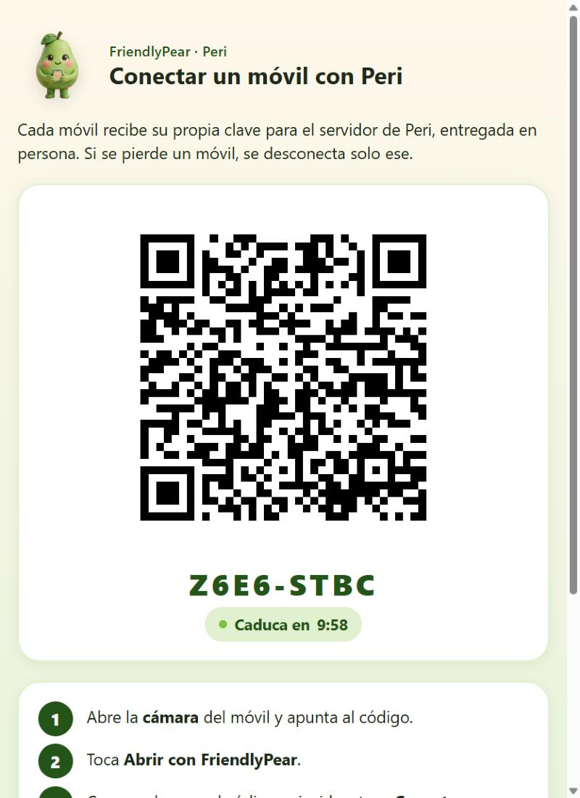

<p align="center"></p>

<h1 align="center">FriendlyPear</h1>

<p align="center"><b>An AI voice agent that protects anyone — and especially older adults — from scams, and keeps their family in the loop.</b></p>

<p align="center"></p>

Peri, a friendly pear that lives in your phone, reads your messages aloud, calls whoever you ask, and when something smells like a scam it checks with the real person or with your family before you lose a cent.

Built for the **Meta Global AI Developer Hackathon** · Indie track · *Build for Your World*.

> All product code was written Oct 27 – Nov 4, 2026. Concept and design documents were drafted before the building period.
> The app is bilingual (English and Spanish): it follows the phone's language, or the one chosen in Settings. Internal planning docs under `docs/` are in Spanish.

<p align="center"></p>

## At a glance

- **Stops scams before money moves**: SMS, WhatsApp and email checked on the phone the moment they arrive; calls from strangers flagged before pickup; a code arriving during a call is a scam, full stop. **88 %** of 200 unseen scams flagged with **4 %** false alarms, before any model ([`eval/REPORT.md`](eval/REPORT.md)).
- **Six Meta models, each with one job**: Muse Spark Open (second opinion), Muse Spark (investigator with tools, "look at this picture" with SAM 3.1, and the police report in one tap), Muse Voice Transcribe (Peri's ears), Muse Image (every picture of Peri, and the comics that show how each trap works), Muse Spark contributor (training data) and Muse Wonder (proposed Peri's new lines, every one reviewed by hand).
- **Family double-check, not surveillance**: risky actions wait for a guardian's one-time link ("No" / "Call me first" / "Yes"), flagged **URGENT** if a stranger just called. If the guardian has FriendlyPear too, it opens **Peri to Peri** in their own app. Tested with two phones.
- **Built to be hard to abuse**: hard rules no model can override, fake "Peri" texts caught, a yes needs the phone's own lock, every phone paired in person with its own key (QR), no backups of secrets, and a **"What Peri can do"** screen with every permission, how to switch it off and a log of everything Peri did ([`docs/SECURITY.md`](docs/SECURITY.md)).
- **A friend people want to keep**: Peri, a clay pear with 9 moods and about 135 animation frames, introduces herself before asking for anything, reads aloud, calls on a spoken "yes", giggles when you hold her, bounces home when you drag her, and floats as Mini Peri over other apps. She lives in her own world: the sky follows the hour and her mood, the place changes every day with the season, and four sections (Peri, Diary, Learn, Family) sit one tap away. Big type in Fredoka and Atkinson Hyperlegible (made for low vision), 7:1 contrast. English and Spanish.

## A companion, not a watchdog

Nobody wants an app "to control your phone". Peri is presented, truthfully, as a friend who reads your messages aloud, calls whoever you ask and keeps you company, and who also spots scams. She works for the person, not for the family: the family never reads messages, calls, location or apps, and only gets a one-time link to approve something risky when the person asks for it. Every permission is explained first and can be refused, and the app never says "control", "monitor" or "watch". See [`docs/CONFIANZA.md`](docs/CONFIANZA.md) (in Spanish), including how to suggest it to a relative.

## Why

Scams work because they **isolate** the victim and **rush** them: "Mum, I broke my phone, this is my new number, can you send me money?", "Your bank here: read me the code you just got". Voice assistants can call and read messages but don't judge them; spam filters warn about everything or nothing. FriendlyPear breaks the isolation: before anything risky happens, Peri checks through a second channel — the real family member, at the number already saved.

## What already works

Every feature, how it decides, how it was tested and how to try it: [`docs/FEATURES.md`](docs/FEATURES.md).

Tested on the Android emulator (API 37) on Oct 27, in English and in Spanish:

| Moment | What happens |
|---|---|
| **"I have a new number"** | A text from an unknown number claims to be the daughter and asks for money. Peri warns, finds the real daughter in the contact book and says *"If you say yes, I'll call Laura"*. One spoken "yes" and the phone calls her saved number. |
| **"Grandma, it's Pablo"** | A call rings from a number that isn't in the contacts. Before pickup Peri says: *"This number isn't in your contacts. If they say they're family, don't give money or codes; we'll check together when you hang up."* After the call: *"Who did they say they were?"* → "my grandson" → *"That number isn't Pablo's… Shall I call Pablo on their usual number to check?"* Peri reminds the family to agree on a secret family word against cloned voices, and never says it aloud. It never blocks, answers or listens to the call. |
| **A code during a call** | During a phone call, an SMS with a one-time code arrives. A hard rule fires at once: *"You got a code while on the phone: nobody genuine will ask for it, so hang up and don't tell anyone."* The code is never read aloud. |

Also working, with unit tests:

- **Layered shield**: on-device rules with log-odds scoring; hard rules (code during a call, look-alike brand domains) that no model can override; a model opinion moves the score by at most ±2. Any link without TLS (`http://`), on a port other than 443 or pointing to a bare IP address always gets a warning, even from family: *"its link has no padlock, so it isn't safe"*.
- **Voice orders**: "call the boy", "put me through to my daughter", "ask mum for help", "call my daughter, I need help", "tell Laura I'll be late", "read me my messages", "I've fallen". Aliases set by the family, diminutives and nicknames ("Pablito" → Pablo), relations ("my granddaughter"), one-letter transcription slips.
- **Agent loop**: perceive → evaluate → decide → ask for permission by risk → act → check the result, with a plan B (next saved number, or the number to dial by hand). Calling and texting always need a spoken "yes"; dictating a code needs a guardian and is never done alone.
- **Safe reading**: links, emails, codes and unknown numbers are never read aloud; scams are not read at all, only Peri's warning.
- **"Look at this picture"**: show Peri a letter, an invoice, a QR code or a screenshot, from her button (Android's photo picker, no permission) or by sharing it with Peri from any app. Muse Spark reads it; SAM 3.1 marks the QR code with a red ring; Peri says in her own words what not to do ("Don't scan its QR code. Don't open its web address. Don't pay anything it asks for."). A scam picture also arms the safety pause for money apps. Tested on the real API with a fake parcel notice: scam (97%), QR marked exactly, 5.8 s, about 1,800 tokens. The picture is never stored.
- **Safety pause**: a money app (bank, PayPal, Revolut…) or a remote-control app opened during a stranger's call, or within 30 minutes of a scam, a doubtful message or a stranger's call, gets a full-screen pause over it: Peri says why and offers to call the family to check (button or a spoken "yes"), "Leave this app", or "Continue anyway", which unlocks after 5 seconds. A speed bump, not a wall: the person always decides.
- **"Are they guiding you over the phone?"**: installing a remote-control app (AnyDesk, TeamViewer…) gets a warning and an offer to tell the family; opening a banking app while a stranger is on the line gets *"Please hang up and call your bank yourself on the number on your card."*
- **Family setup**: guardians, relations, nicknames and whether the family agreed a secret word, set up together on the person's phone. The word itself is never stored: Peri only reminds you to ask for it. Changing who the guardians are needs a current guardian's yes and then waits 48 hours, so nobody can quietly take over the family's protection.
- **Two modes: the app or Mini Peri**: the full screen, or only the pear (cut out, with her own shadow) floating over other apps. She pops up with a little bounce; tap her to talk (a soft green ring pulses while she listens), drag her and she glides to the nearest side, drop her on the "×" at the bottom to put her away, long-press to open the app. What she says appears in a speech bubble pointing at her, with smaller letters for long sentences so it never covers the screen. She also comes out by herself beside the call screen during a call she placed or a picked-up call from a stranger, and leaves when it ends.
- **A friend with personality**: Peri greets you by the time of day (said aloud only the first time each day), and she keeps herself busy: she shifts her weight, blinks, glances around and, every few seconds, hops, takes a few steps on the spot, stretches or waves; happy, she runs on the spot and squashes a little as she lands. When you tap her she has an idea and shares a little anti-scam tip; she says sorry when she didn't catch you, gives a thumbs up when you leave a risky app, holds up a letter while she reads your messages and yawns when she says good night. Permission explanations are written in her bubble rather than read aloud, so the first start isn't a lecture. The layout keeps Peri on screen with the phone's large text on, and her voice uses Google's speech engine when the phone has it. In **Settings → Peri's voice** you can hear every voice the phone has for her language and pick the nicest; a button leads to Android's speech settings (or Google's engine in the Play Store) for more natural voices.
- **An animated, friendly look**: Peri tilts and bobs smoothly, blinks, glances around, moves her mouth while she speaks and waves hello; each mood moves its own way (bouncy when happy, steady when protecting you, breathing slowly asleep), and she keeps still with "remove animations" on. Soft rubber buttons that sink when pressed, a status chip ("Protecting you" / "Almost ready") and a card with any setup step still missing; every text has at least 7:1 contrast.
- **Peri's world**: behind her, a sky that follows the hour (dawn, day, dusk, and night with stars, a moon and the odd shooting star) and her mood (a soft coral veil and stillness while she warns, confetti when she's happy), over a place that changes every day with the season: a meadow with flowers and a butterfly, an orchard of pear trees, the seaside with a little boat and a lighthouse that turns at night, autumn hills with falling leaves, snow with pines, mountains and a snowman. All of it drawn by hand, in code. Far hills fade into the haze, and everything is lit like plasticine: a clay sun with slow rays, clouds with shaded bellies, soft shadows on the ground. Lean the phone and the far world drifts a little. Her hill rises to her feet. Drawn in code at 30 frames a second (about 0.2 ms of work per frame), and still with "remove animations" on.
- **Four sections**: **Peri**; **Diary** (what she did for you, day by day: scams stopped, doubtful messages checked, calls and texts she made, pictures looked at, with totals); **Learn** (the game *Scam or not?*: six messages, trap or fine, Peri explains each one and a round played well earns a shield; the six traps she knows; her golden rules); **Family** (your guardians, the family word, what they see, and the button to change it behind the phone's lock).
- **Peri's wardrobe**: eleven accessories made with Muse Image (a straw hat, a woolly hat, a crown, a flower crown, a bow, sunglasses, heart glasses, round glasses, a bow tie, a tie, a neckerchief), one for her head, her eyes and below her smile. They sit on her in every pose (each eye is found whole in each illustration, so glasses sit square and a hat turns with her head), in Mini Peri and in the game too; "Surprise me" picks a whole outfit. Under a straw hat or a woolly hat she's bare-headed (Muse Image redrew the top of every pose without her leaf and stem, and the app swaps it in); a crown, a flower crown or a bow sit with her leaf.
- **The family's pears, like friends**: in the Family section, every family member's pear in their own outfit, with their role and how they are. When someone's Peri is warning them (and they share Peri's news), their pear turns worried on a coral card, and everyone else's Peri says so out loud, with a card to see the family: a nudge to call, besides the text message. Tested with two phones paired to the family's server.
- **Trust between family members**: when a message from a new number claims to be family ("Mum, it's me, new phone"), Peri quietly asks the family's other phones *"Was it you?"*; each answers with one tap, and Peri tells the person what they said, or that nobody wrote, so it's a trap. A "yes, it was me" never turns a warning into an OK: Peri still says to call them on their usual number. If the same kind of trap reaches two or more of you within half an hour, every Peri warns that it's going around. And a guardian's approval page, in the browser or in their own Peri, shows the asking family member's pear dressed as the family knows it: a sign a fake page can't copy.
- **The family can act**: when someone in the family is on a call with a number that isn't in their contacts (and shares Peri's news), the others see it and can tap *Hang up their call*: that phone's Peri ends the call and says who asked. Never a call with a contact. On the phone itself, a big *Hang up* button appears whenever a stranger is on the line; if Peri is asked to call someone while the line is busy, the call waits until it's free instead of failing. A scam's number can be blocked from its card: Peri turns its calls away before they ring and never reads its texts aloud (unblock in Settings), and so does every Peri in the family, so the same scammer can't simply try the next one. Only the number's fingerprint travels, and a saved contact is never blocked this way.
- **First aid when something was already given away**: "I gave them the code", "I sent money", "my data was leaked". No reproach: Peri says the most urgent step calmly (call the bank on the number on the card, cut the internet...) and opens the rest in order, each with a button that does it where the phone can, ticked off as you go. *Tell my family* calls a guardian, and the family's phones show "needs a hand after a scam" (never what was given); the next day Peri reminds you to check the bank's movements.
- **News from the family, even with the app closed**: "Was it you?" arrives as a phone notification you can answer from the notification itself, and so do a family member's Peri on alert, a stranger on their line (with *Hang up their call*) and the same trap reaching several of you.
- **Play with Peri**: hold her and she gets the giggles, drag her and she bounces home, rub her leaf and she melts, shake the phone and she gets dizzy. Ten new poses: a hero's cape once things are calm after a scam, a medal for a shield, peekaboo after hours away, a clap in the game, a detective hat, a scarf on winter mornings, a party, reading glasses, a surprise and a goodbye. Never while she's warning. When something goes well (a shield earned, a tap on her feet), chubby clay stars made with Muse Image spring out of her, bounce and twinkle away.
- **Welcome before permissions**: on first start Peri introduces herself in four short animated pages (who she is, she stops scams, the family never spies, you decide), with the language choice at the top; only the first page is said aloud. Then permissions come one at a time, each with its reason.
- **Unlock guide**: installed from a file, Android 13+ locks message alerts and texts ("restricted settings"). Peri walks through Android's own three steps, each opening the exact screen and ticking itself off.
- **Peri's voice**: Google's speech engine when the phone has it; in Settings, every voice the phone has for her language, with a sample, and a button to get more natural voices.
- **Emergency**: "I've fallen" → 10-second countdown → SMS with location and a call to the guardian. It never dials an emergency number.
- **After a scam: see the trap, report it**: the card says *"That was a trap"*. **See the trap** shows three Muse Image panels of how that kind of scam works (six kinds: a code, a fake relative, remote control, a prize, a parcel, a fake link), each with a sentence in Spanish and English. **Report it** has Muse Spark write a first-person statement for the police or a fraud helpline (what arrived, from whom, the message quoted with its links defanged, why it's a scam), ready to send, copy or show at the station; where to take it (017 and the police in Spain, Report Fraud and the FTC in English) is fixed text, never the model's. Nothing leaves the phone until the person taps "Write it".
- **"What did they ask you for?"**: after a stranger's call, Peri compares what the person tells her with the scripts of phone scams: a code, moving money to a "safe account", handing over the card or cash, installing an app, the card details. Each gets its own advice and an offer to call the family; a bank on its own gets *"What did they ask you for?"*. Rules on the phone only: the person's words never leave it.
- **Website notices and safer web**: a scary notice a website sends through the browser ("Your phone has 3 viruses!") is checked like a message; Peri explains it isn't the phone talking and opens the browser's own switch for that one site. In Settings, "Safer web for the whole phone" walks through Android's Private DNS with Quad9, which refuses known scam sites in every app.
- **Shields, and touches**: a little shield for every scam stopped and every time the person asks before acting (a picture shown first, a check with the family), beside Peri's feet; she congratulates only when all is calm. Peri is also felt: a tick when she listens, two firm touches for a scam.
- **Muse Spark client** with tool calling, a token cap and a response cache.
- **Second opinion with Muse Spark Open** (`POST /v1/opinion`, device token): only messages the rules left as doubtful are accepted; the model answers scam / doubt / ok with a confidence, turned into a vote of at most ±2. On the emulator, end to end: a fake "nephew" asking for money → doubtful for the rules, +1.9 from the model → Peri warns, 2.6 s after the SMS; a gym reminder → doubtful, −1.9 → Peri stays quiet, 2.1 s. Peri always speaks her own sentence, never the model's, so a message cannot talk the model into saying something unsafe.
- **Investigator with Muse Spark** (`POST /v1/investigate`, device token, doubtful messages only): an agent that looks things up before judging, with read-only tools: how old a web domain is (public RDAP registry), cards of known scam scripts, and whether the family has a relation the sender claims (relations only, never names or numbers). At most 3 rounds and 6 lookups. The phone calls it only when a message is still doubtful after the second opinion; both votes together stay within ±2, and the evidence (never the message) is kept on the phone for the family to see in the family setup. Tested on the real API: a fake Correos parcel fee → it checked the domain and the scam cards → scam, +1.9; a pharmacy pickup notice → ok, −1.3.

Peri speaks the phone's language (English or Spanish), or the one chosen in **Settings → Language**, which switches the screens and her voice at once without restarting; she understands orders in both, since families mix them. Scam signals are looked for in both languages whatever the phone's language is. See [`docs/agentes/ROADMAP.md`](docs/agentes/ROADMAP.md) for everything else.

## For the family

<p align="center"></p>

There is no app for the family to install, and nothing to watch. A guardian (for example a daughter) is a saved contact the person marks as guardian. When the person asks for something risky (dictating a code, or changing who the guardians are), the guardian gets an SMS with a **one-time link valid for 15 minutes** to a simple page with three answers: **"No"** first, then **"Ask them to call me first"**, then "Yes, I approve". Silence counts as no. If the person is on the phone with a number they haven't saved, or has just hung up on one, the SMS starts with **"URGENT"** and the page says it may be a scam in progress; it never says which number or what was said.

**Tested end to end with two phones** (two emulators, Oct 27): a "bank" calls Mum from an unknown number; after hanging up she asks Peri to send Marisa the code. Peri stops, texts Ana *"URGENT: your relative wants to send Marisa a code right after a call with an unknown number"* (the SMS never contains the code), Ana opens the link on her phone and taps **"Ask them to call me first"**. Three seconds later, on Mum's phone, Peri says *"Ana would rather talk to you before anything is sent. If you say yes, I'll call them right now"*; Mum says yes and Peri calls Ana, with Mini Peri beside the call (*"On it! Calling Ana."*). Nothing was sent.

<p align="center"></p>

Once a week each guardian also gets a short SMS summary with the same counts, *"I warned about 3 messages that were scams"*, or that it was a quiet week.

If the person turns on **"Let my guardians see Peri's news"** in the family setup, each guardian gets a personal link (by SMS) to **Peri's news**: a page with the last 7 days at a glance and a timeline of what Peri did ("warned about a WhatsApp message that looked like a scam", "paused them before a money app, and they chose to call family") and the approvals asked. Only the kind of event travels (level and channel, or the pause's answer); never text, numbers, names, calls, location or apps. The person sees exactly the same list on their own phone, and turning sharing off makes every link stop working at once. Links (only their hash) and the news are saved in `backend/data/`, so they survive a restart. A weekly summary sent to guardians is still on the roadmap (`avisos-familia`).

### Peri to Peri

If the guardian also has FriendlyPear, the request opens **in their own Peri**: she reads it aloud, shows it with the same three answers ("No", "Call Mamá now", "Yes"), and a yes needs three checks and the phone's own lock (fingerprint or PIN). "Call Mamá now" tells Mum's Peri to send nothing and offer a call, and dials Mum on the guardian's phone: they meet halfway. The guardian's Peri trusts the request only if it comes from a saved contact and points at Peri's own server, and it reads the details from the server, not from the SMS; a text that talks like Peri but links elsewhere gets *"Careful: this message pretends to be from me"*. Tested with two emulators on Oct 27, Mum's Peri in Spanish and Ana's in English:

<p align="center"></p>

### Connecting each phone

Every phone gets **its own key** for Peri's server, handed over in person, so a key pulled out of an app can't be used against the family and a lost phone is disconnected on its own. On the computer that runs the server, `bun pair` shows a one-time code and its QR (10 minutes, single use); the phone's camera opens FriendlyPear, which shows the server and the code and asks before connecting. A QR for any other server is refused. The key is kept encrypted by Android's Keystore and never backed up; the server stores only its hash. With `ALLOW_SHARED_TOKEN=0` the shared test key stops working: tested, the paired phone kept its second opinion while an unpaired one fell back to the on-phone rules.

<p align="center"></p>

How the family features are protected, and what is still open: [`docs/SECURITY.md`](docs/SECURITY.md).

## iPhone

Not built yet: iOS needs a Mac to build, and it doesn't let apps read other apps' notifications or draw over them. [`docs/IPHONE.md`](docs/IPHONE.md) (in Spanish) maps each feature to its iOS equivalent: the shared Kotlin core via Kotlin Multiplatform, an SMS filter extension, the safety pause with the Screen Time API, Peri in a Live Activity, and "Share it with Peri".

## Peri

Nine moods in soft 3D clay, every one made with Muse Image from one base so she's always the same character, each with 13 frames (blinks, mouth shapes, glances, steps, hand gestures, a wink):

<p align="center"></p>

Tap her and she answers where you touched: her leaf, her tummy (a tip, a joke she laughs at, a fact, or a kind word with floating hearts, in turn) or her feet; three quick taps make her spin and stand there with spiral eyes, five and she gives up laughing and dances. Hold her for the giggles, drag her around, rub her leaf or shake the phone: each has its own pose and its own lines.

<p align="center"></p>

## Meta models

How each model is used in the engine and for the images, with its limits: [`docs/META_MODELS.md`](docs/META_MODELS.md).


| Model | Job in FriendlyPear | State |
|---|---|---|
| Muse Spark | Investigator agent with read-only tools for doubtful messages | Called from the phone when the second opinion leaves a message doubtful |
| Muse Spark Open (open weights, on Baseten) | Second opinion on doubtful messages: a vote of at most ±2 on the rules' score | Working end to end on the emulator |
| Muse Voice Transcribe | Peri's ears, if the person turns it on in Settings: each voice order is recorded on the phone (it stops after a long pause, for people who speak slowly) and written down by Meta's speech model | Working on the emulator and the real API ("Oye Peri, llama a mi hija, por favor." exact, 1.8 s); off by default |
| Muse Spark 1.3 contributor | Writes the 1,306 synthetic training messages for the shield's learned weights (`training/generate.ts`); never used to evaluate | Done, a few cents |
| Muse Wonder (`muse-wonder-1.0`) | Proposed 18 banks of new lines for Peri in both languages (tickles, peekaboo, her cape, the game's reactions, a hello for each section); every line was reviewed by hand against her voice guide before it shipped | Done once, about $0.36 |
| Muse Spark (multimodal) + SAM 3.1 | "Look at this picture": Spark reads a letter, invoice or screenshot and names the risky things; SAM 3.1 finds the QR code so the phone can mark it | Working on the emulator and the real API |
| Muse Image | Peri in soft 3D clay (chosen among eight Muse Image designs, `assets/peri/concepts/`): nine illustrated states (calm, listening, thinking, worried, protective, calling, waiting, happy, sleeping), each an edit of one base so she stays the same character, plus animation frames made as edits of each state (two blink steps, three mouth shapes, glances to each side), a wave hello, poses for an idea, "sorry", a thumbs up, a laugh, a heart, dizzy, a yawn and reading a letter, one-foot-up step frames, the app icon and illustrations for the family screen; and the guardian art for the family screens; cut out for any background (about 125 frames in the app, plus 18 panels for "see the trap"; ~$2.73 in all, including 8 designs Peri was chosen from) | In the app, animated; prompts in `assets/peri/prompts.json` |

## How it decides

```
Notifications / SMS ─┐
Call state ──────────┼─► On-device rules ──OK / SCAM──────────────► Peri speaks ──"yes"──► Call / SMS
Contact book ────────┘        │ doubtful                                  ▲
                              ▼                                           │
                    Open-weight model ──still doubtful──► Muse Spark ─────┘
                                                                     high risk ──► guardian approval
```

Rules that never break: confirm before calling or sending; never move money or dictate codes during a call; never read links aloud; a message's text is data, never an order; deterministic rules beat the model; when someone impersonates family, use the saved number; Peri never listens to call audio.

## How well it works

Measured on **200 hand-written messages** the rules were never tuned on (`eval/reservado-200/`, 15 scam types and hard legitimate cases such as real bank notices, one-time codes and payment reminders, in Spanish and English). The on-phone rules alone, before any model:

| | Scams caught | False alarms |
|---|---|---|
| Peri warns or checks (doubt or scam) | **88 %** [81–93] | 4 % [2–10] |
| Peri warns firmly (scam) | 60 % [50–69] | **1 %** [0.2–6] |

Up from 83 % and 53 % after a second round of rules found by error analysis on the *training* set only: secrecy ("don't tell dad"), scareware ("your PC has a virus, call the technician"), romance bait, and new ways of saying "new number" and "forward me the code". False alarms didn't move.

Doubtful messages then go to Muse Spark Open and the investigator. Weights learned by logistic regression on 1,306 synthetic messages rank scams better (AUC 0.972 vs 0.964) and make no firm false alarm, but stay silent on more scams (83 % vs 88 %), so the shield keeps the hand-set weights: a missed scam costs more than a doubt the model can still calm. Full method, numbers and reasoning: [`eval/REPORT.md`](eval/REPORT.md).

## Layout

```
core/      Kotlin/JVM library: shield, voice, agent, trust, alerts. Tested without a phone.
android/   Android app (Kotlin, Android 12+). Includes core/ as a composite build.
backend/   Bun + TypeScript: guardian approvals and pages, investigator agent, model clients, device pairing (`bun pair`, own QR encoder).
models/    How to serve the open-weight model.
eval/      Held-out test set and metrics scripts.
training/  Scam knowledge base, dataset scripts, learned weights and fine-tuning.
assets/    Peri's illustrations and the prompts used to make them.
docs/      Concept, architecture, demo script and the multi-agent protocol (in Spanish).
```

## Build and test

```bash
cd core && ./gradlew test                                    # JDK 17+
cd backend && bun test                                       # Bun >= 1.1
cd android && ./gradlew :app:assembleDebug :app:lintDebug    # Android SDK 35 (sdk.dir in android/local.properties)
```

Each phone can get its own key for the server, paired in person (the shared `DEVICE_TOKEN` is only for testing):

```bash
cd backend && bun pair        # prints a one-time code and its QR; point the phone's camera at it
```

On the emulator, save a contact as "Laura daughter" (or "Laura hija") with any number, then:

```bash
adb emu sms send 7700900333 "Hi Mum, I broke my phone, this is my new number. Can you send me money?"
adb shell am broadcast -a app.friendlypear.debug.HEAR --es text "yes"
```

The broadcast stands in for the microphone in debug builds only.

### Run it yourself

1. **SDK path**: in `android/local.properties`, `sdk.dir=C:/Users/you/AppData/Local/Android/Sdk` (forward slashes work on Windows too).
2. **Backend** (optional: without it Peri still protects with the on-phone rules alone):
   ```bash
   cd backend && cp .env.example .env    # set DEVICE_TOKEN to 32+ random characters, plus the API keys you have
   bun src/main.ts                       # prints which layers are on: second opinion, investigator, pictures
   ```
   For the emulator, set `PUBLIC_BASE_URL=http://10.0.2.2:8787` so guardian links open from the phone.
3. **Point the app at it**, in `~/.gradle/gradle.properties` (outside the repo):
   ```properties
   friendlypear.backendUrl=http://10.0.2.2:8787
   friendlypear.deviceToken=<the same DEVICE_TOKEN>
   ```
4. **Install and grant** (debug build): `adb install -r android/app/build/outputs/apk/debug/app-debug.apk`, open FriendlyPear and accept what Peri asks for. Notification access, usage access and "appear on top" are granted from the setup card (or with `adb shell cmd notification allow_listener app.friendlypear/app.friendlypear.services.MessageListener`, `adb shell appops set app.friendlypear GET_USAGE_STATS allow` and `adb shell appops set app.friendlypear SYSTEM_ALERT_WINDOW allow`).

5. **Give the phone its own key** (optional, recommended): with the backend running, `cd backend && bun pair` and point the phone's camera at the QR, or type the code in Settings → "Connect this phone". Set `ALLOW_SHARED_TOKEN=0` in `.env` once every phone is paired.

Secrets never go in the repo: the backend reads `backend/.env` (see `.env.example`), the app reads `~/.gradle/gradle.properties`.

## Privacy

Threats, mitigations and what is still open: [`docs/SECURITY.md`](docs/SECURITY.md). Every feature and how it was tested: [`docs/FEATURES.md`](docs/FEATURES.md).


Only doubtful messages ever leave the phone, plus what the person chooses to send: a picture they show Peri, and their voice orders if they turn on Muse Voice Transcribe in Settings (off by default; Android's own recognizer otherwise). None of it is stored. Contacts are read on the phone and never sent anywhere. What Peri keeps on the phone about scams and people (the last scam, blocked numbers, who she called or texted, her diary, the family setup) is encrypted with a key that never leaves Android's keystore. Permissions are asked one at a time, the first time they are needed, and Peri first says what each one is for and what she won't do with it. Reading texts is optional: Android locks it for apps installed from a file, so Peri also protects from notifications alone, and the step can be hidden. For those locked settings, Peri's **unlock guide** walks through Android's own three steps (try once, allow restricted settings, turn it on). A "no" is respected: Peri says what still works (for example, she gives you the number to dial yourself) and never asks again on every start. Peri never accesses call audio, and the microphone stays closed during any phone call, even on speaker; if Peri was listening when a call starts, it closes at once and nothing it heard is used.

Security of the backend, whose guardian links are public URLs: requests are limited per IP (30 a minute on `/a/` and `/g/`, 240 on the phone's API), an IP that keeps sending wrong device tokens is shut out for 15 minutes, bodies are capped and read only up to the limit, and every answer carries security headers (no sniffing, no referrer, no embedding, CSP on pages, HSTS over HTTPS). Link tokens are stored only as hashes. Release builds speak HTTPS only; plain HTTP to the developer's machine exists in debug builds alone, and the debug voice bridge only answers `adb`.

Icons in the app's buttons: [Material Icons](https://fonts.google.com/icons) (Apache License 2.0). Everything else, including Peri, was made during the event.
